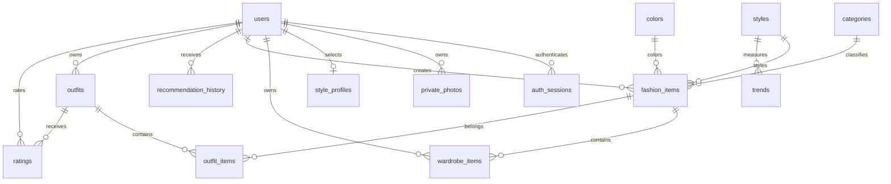

# Fashion Balance AI V1.9 ERD

`auth_links`: 이메일 인증 전 임시 토큰. SHA-256 해시만 저장, 15분 만료, 사용 시 트랜잭션으로 삭제합니다. 이메일은 users UNIQUE 키로 연결됩니다.
`auth_limits`: IP/이메일의 해시별 시간당 요청 제한. 세션·인증링크 만료 데이터는 관리자가 정기 삭제할 수 있습니다.
`auth_sessions`: user_id FK, 토큰 해시 PK, 30일 만료.
`private_photos`: filename PK, user_id FK. 파일은 private/uploads 에 보관합니다.
`recommendation_history`: id PK, user_id FK, payload JSON, 생성시각. 최근 30회 추천 결과 조회.
기존 outfits/outfit_items/ratings/seasonal_looks 구조는 보존합니다. V1.9 이력은 기존 테이블을 변경하지 않고 별도 저장합니다.

V2에서는 위 MySQL 구조를 그대로 사용합니다. React가 API를 호출하고 Python이 동일 테이블에 접근합니다. V1.9 적용 완료 DB에는 V2 추가 DDL이 없습니다.
